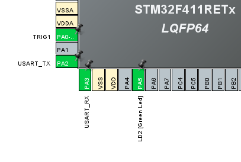
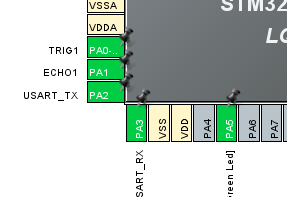
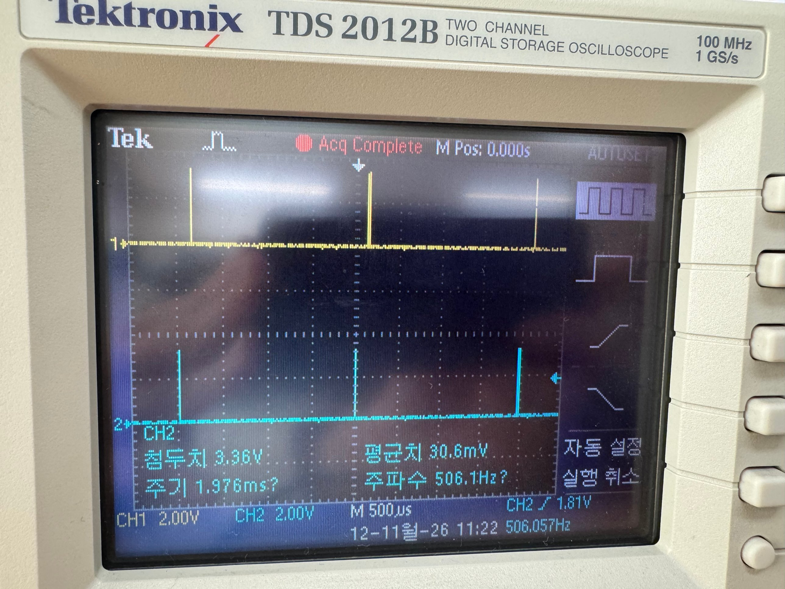
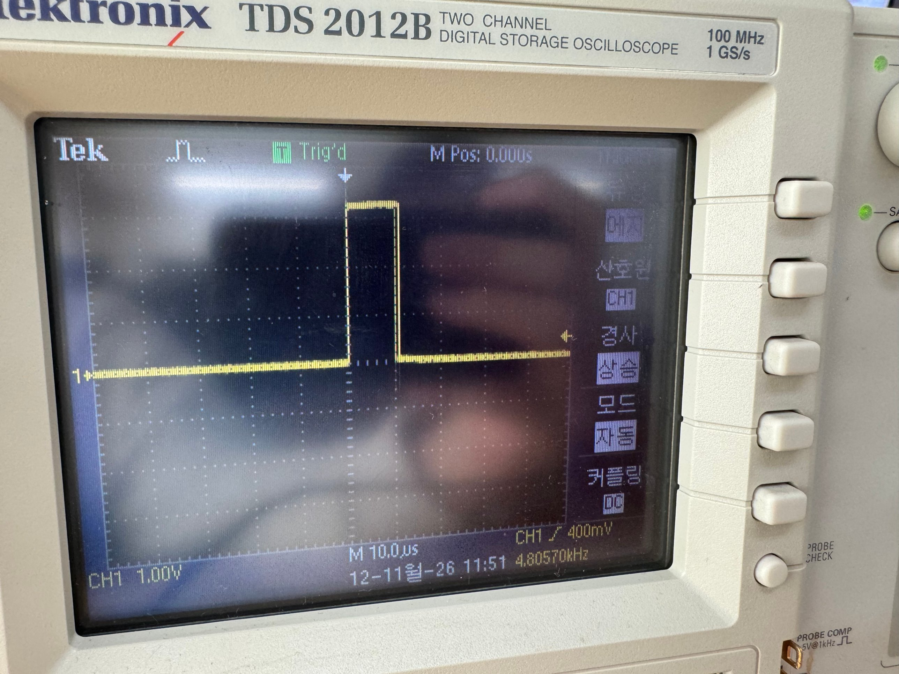
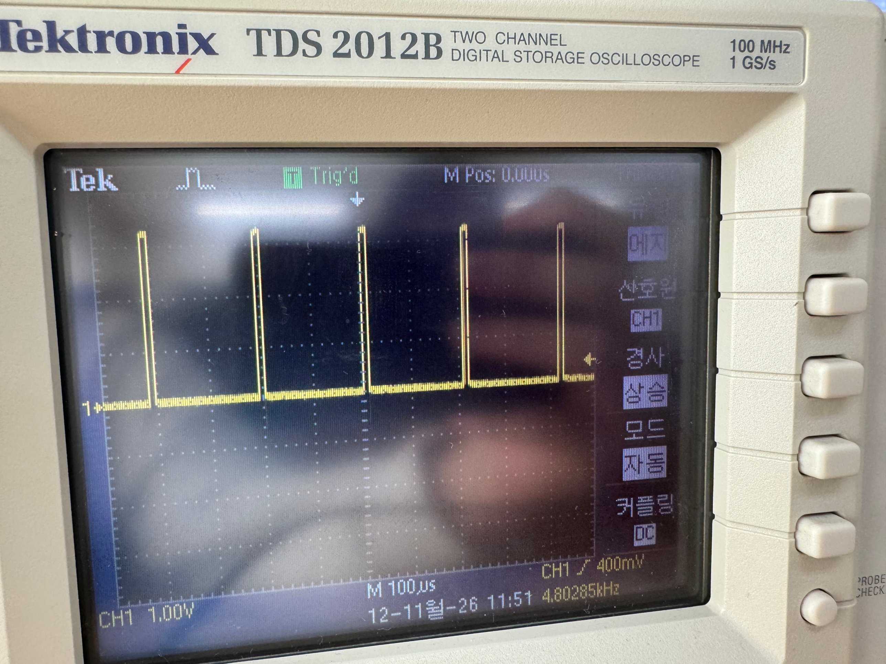
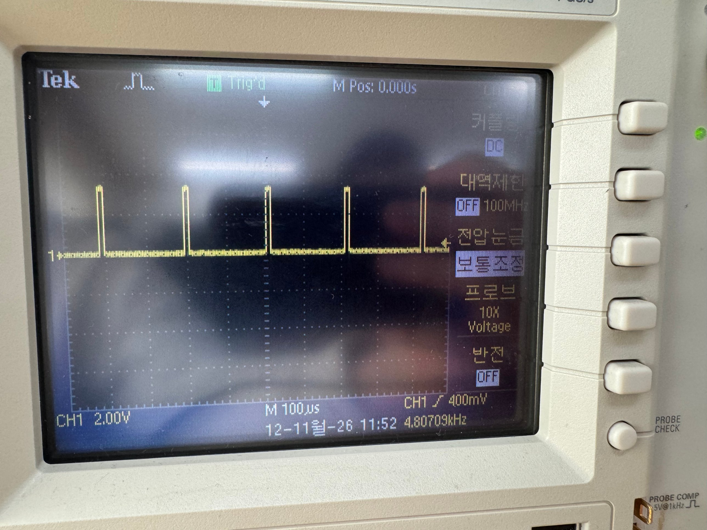
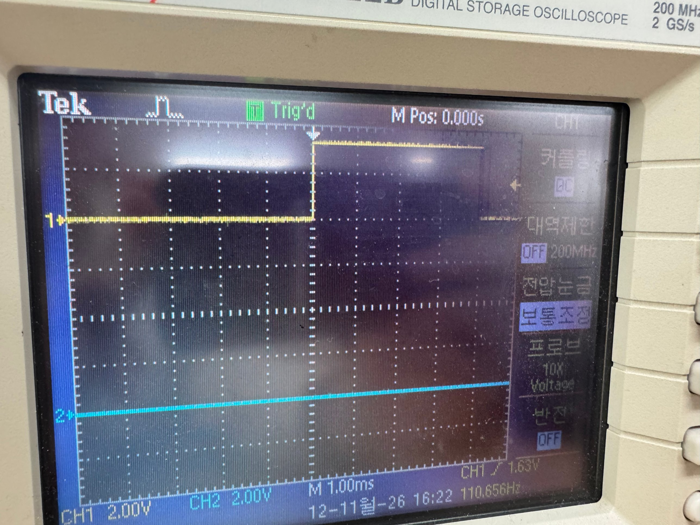
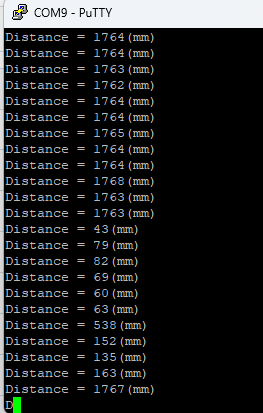

# 실습: HC-SR04 초음파 센서 거리 측정 (STM32F411RE)

HC-SR04의 TRIG 핀에 10µs 이상의 High 펄스를 주면 센서가 초음파를 발사하고, 반사파가 돌아올 때까지 ECHO 핀이 High를 유지합니다. 이 High 시간(echo 시간)을 측정해서 거리를 계산합니다.

- 음속: 약 340m/s
- 거리(mm) = echo 시간(µs) × 0.17 &nbsp;(왕복 거리이므로 2로 나눔)

측정은 오전(TRIG 펄스 확인)과 오후(TRIG + ECHO로 실제 거리 측정)로 나누어 진행했고, 오실로스코프는 Tektronix TDS 2012B의 **CH1(노란색 파형)** 으로 측정했습니다. CH2(하늘색) 파형은 이번 실습과 무관합니다.

## 1. CubeMX 핀 설정

| 오전 (TRIG만 설정) | 오후 (TRIG + ECHO 설정) |
|:---:|:---:|
|  |  |
| PA0 = TRIG1, PA1 = 미설정 | PA0 = TRIG1, PA1 = ECHO1 |

- 공통: PA2 = USART_TX, PA3 = USART_RX, PA5 = LD2
- 오전에는 ECHO 핀(PA1)을 설정하지 않고 TRIG 출력 파형만 확인했습니다.

## 2. 오전: TRIG 신호 파형 측정 (CH1 = TRIG1, PA0)

| 11:22 (500µs/div) | 11:51 (10µs/div) |
|:---:|:---:|
|  |  |
| CH1 2.00V/div, 좁은 펄스가 약 4div(약 2ms) 간격으로 반복 | CH1 1.00V/div, 펄스 폭 약 1div → 약 10µs |

| 11:51 (100µs/div) | 11:52 (100µs/div, 프로브 10X) |
|:---:|:---:|
|  |  |
| CH1 1.00V/div, 펄스 간격 약 2div(약 200µs대), 주파수 표시 4.80kHz | CH1 2.00V/div, 동일한 파형, 주파수 표시 4.807kHz |

- TRIG 펄스 폭은 약 10µs로, HC-SR04가 요구하는 트리거 조건(10µs 이상 High)을 만족합니다.
- High 레벨은 1.00V/div 기준 약 3div(3V대)로, GPIO 출력 High(3.3V 부근)에 해당합니다.
- 오전에는 ECHO를 사용하지 않았기 때문에 TRIG 펄스가 짧은 간격으로 반복됩니다. 실제 거리 측정 시에는 센서 사양상 측정 주기를 60ms 이상 두는 것이 권장됩니다.

## 3. 오후: ECHO 신호 측정 + 시리얼 출력 (TRIG1 = PA0, ECHO1 = PA1)

 <br>

- 16:22, CH1 2.00V/div, 1.00ms/div, 트리거: CH1 상승 에지(1.63V)
- CH1(ECHO1)이 Low에서 High로 올라간 뒤 화면 기준 약 5div(약 5ms) 이상 High를 유지합니다. 이 High 유지 시간이 거리에 비례하는 echo 시간입니다.

시리얼 터미널(PuTTY, COM9)로 출력한 거리값입니다.

 <br>

| 구간 | 출력값 (mm) |
|:---:|:---|
| 처음 (센서 앞 거리 고정) | 1762 ~ 1768 (편차 ±3mm 이내) |
| 센서 앞 거리를 바꿨을 때 | 43, 79, 82, 69, 60, 63 → 538, 152, 135, 163 |
| 다시 원래 위치 | 1767 |

- 처음 구간의 약 1764mm는 echo 시간 약 10.4ms에 해당합니다. (1764mm ÷ 0.17 ≈ 10,376µs)
- 센서 앞 거리가 가까워지면 출력값이 즉시 작아지고, 원래 위치로 돌아오면 처음과 같은 값(1767mm)으로 돌아오는 것을 확인했습니다.
- 538mm와 같이 갑자기 튀는 값이 가끔 나오므로, 필요하면 이동평균이나 중앙값 필터를 적용할 수 있습니다.

## 4. 사용한 코드 (오후 측정, main.c)

- 시스템 클록: HSI 16MHz → PLL(M=16, N=336, P=4) → 84MHz. TIM1은 APB2(분주 없음)에서 84MHz를 받고 Prescaler = 83 이므로 카운터가 1MHz(1틱 = 1µs)로 동작합니다.
- TRIG1(PA0)은 출력, ECHO1(PA1)은 입력으로 설정했고, `printf`는 USART2(115200bps)로 출력되어 PuTTY(COM9)에서 확인했습니다.

```c
/* USER CODE BEGIN PD */
#define HIGH 1
#define LOW 0
long unsigned int echo_time;
int dist;
/* USER CODE END PD */
```

```c
/* USER CODE BEGIN 0 */
void timer_start(void)
{
   HAL_TIM_Base_Start(&htim1);
}

void delay_us(uint16_t us)
{
   __HAL_TIM_SET_COUNTER(&htim1, 0); // initislize counter to start from 0
   while((__HAL_TIM_GET_COUNTER(&htim1))<us); // wait count until us
}

void trig(void)
{
   HAL_GPIO_WritePin(TRIG1_GPIO_Port, TRIG1_Pin, HIGH);
   delay_us(10);
   HAL_GPIO_WritePin(TRIG1_GPIO_Port, TRIG1_Pin, LOW);
}

uint32_t echo(void) {
    uint32_t start_tick, start_time, end_time;

    // ECHO HIGH 대기 (최대 10ms)
    start_tick = HAL_GetTick();
    while (HAL_GPIO_ReadPin(ECHO1_GPIO_Port, ECHO1_Pin) == GPIO_PIN_RESET) {
        if ((HAL_GetTick() - start_tick) > 10) return 0;  // 10ms 초과 → 실패
    }
    start_time = __HAL_TIM_GET_COUNTER(&htim1);

    // ECHO LOW 대기 (최대 30ms = HC-SR04 최대 측정 시간)
    start_tick = HAL_GetTick();
    while (HAL_GPIO_ReadPin(ECHO1_GPIO_Port, ECHO1_Pin) == GPIO_PIN_SET) {
        if ((HAL_GetTick() - start_tick) > 30) return 0;  // 30ms 초과 → 범위 초과
    }
    end_time = __HAL_TIM_GET_COUNTER(&htim1);

    return end_time - start_time;
}
/* USER CODE END 0 */
```

```c
  /* USER CODE BEGIN 2 */
  timer_start();
  printf("Ranging with HC-SR04\n");
  /* USER CODE END 2 */

  /* Infinite loop */
  /* USER CODE BEGIN WHILE */
  while (1)
  {
	  trig();
	  echo_time = echo();
	  if( echo_time != 0){
	      dist = (int)(17 * echo_time / 100);
	      printf("Distance = %d(mm)\n", dist);
	  }
	  else printf("Out of Range!\n");
	  HAL_Delay(1000);
    /* USER CODE END WHILE */
```

- `trig()`: TRIG를 High로 올리고 TIM1 카운터로 10µs를 기다린 뒤 Low로 내립니다.
- `echo()`: ECHO가 High가 될 때까지 최대 10ms, High인 동안 최대 30ms 기다리며, ECHO가 High였던 시간을 µs 단위로 반환합니다. 시간이 초과되면 0을 반환하고 "Out of Range!"를 출력합니다.
- 거리(mm) = `17 × echo_time / 100` 이며, 루프마다 `HAL_Delay(1000)`으로 약 1초마다 측정합니다. (센서 권장 측정 주기 60ms 이상을 만족)
